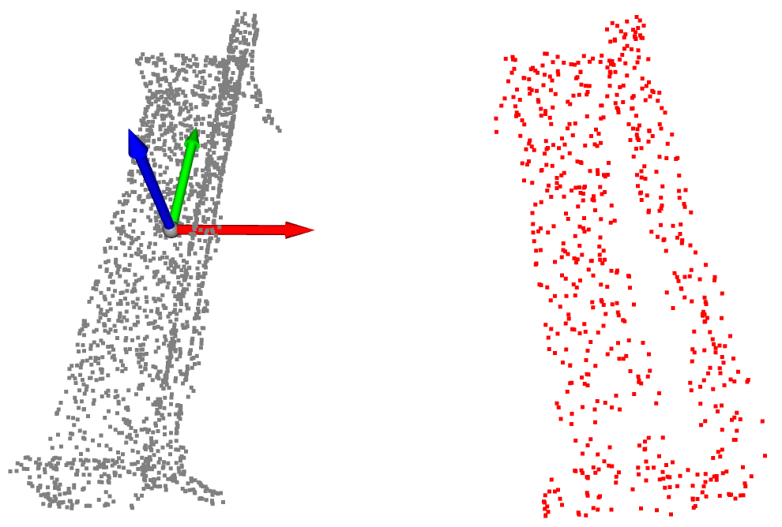
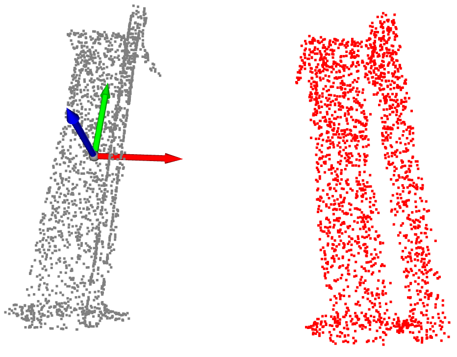
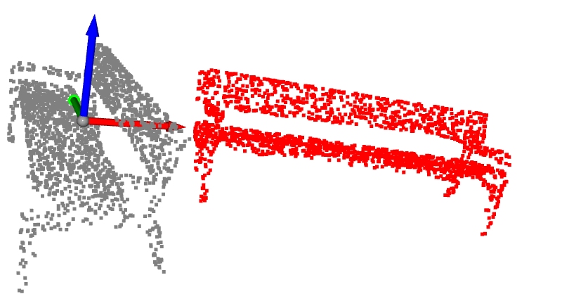
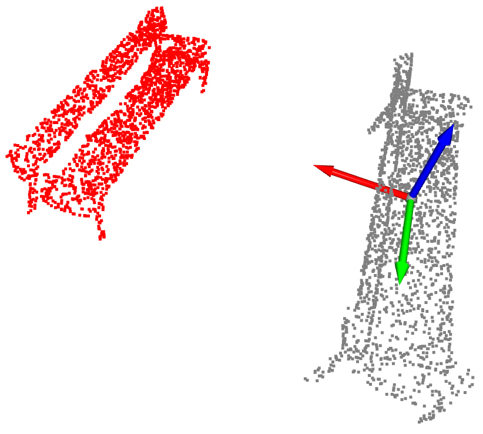

# 3D Point Cloud Classification & Data Augmentation Pipeline

## Research Project: 
An in-depth study on the impact of spatial transformations and synthetic noise on 3D deep learning models using the PointNet architecture.

This repository contains an end-to-end pipeline for 3D Point Cloud classification. It includes a custom implementation of the **PointNet** architecture and a **Data Augmentation** module.

### 🎯 Objective: Mitigating Overfitting in 3D Deep Learning
One of the main challenges in training deep neural networks on 3D point clouds is **overfitting**, particularly because available 3D datasets are often limited in size and diversity. When a network overfits to the training data, its performance may degrade significantly when applied to real-world data captured by noisy sensors.

This project solves that by implementing a custom Data Augmentation pipeline. By mathematically perturbing the point clouds during training (simulating occlusions and LiDAR sensor noise), we force the PointNet model to learn robust, generalized spatial features rather than memorizing exact point coordinates.

---

## 📸 Visualizing Data Augmentation on 3D Point Clouds

To achieve this, I applied different Data Augmentation techniques:

| **Dropout (Occlusion)** | **Jittering (Sensor Noise)** |
|:---:|:---:|
|  |  |
| **Rotation** | **Scaling** |
|  |  |


---

## 🚀 Features & Architecture

- **PointNet Implementation:** A custom PyTorch model (`pointnet.py`) capable of learning global features directly from unstructured 3D point clouds (x, y, z coordinates).
- **Custom Augmentation Module (`augmentations.py`):**
  - 🌫️ **Jittering:** Adds Gaussian noise to simulate LiDAR sensor inaccuracies.
  - 🕳️ **Random Dropout:** Randomly removes a percentage of points to simulate object occlusion.
  - 🔄 **Rotation & Scaling:** Applies spatial transformations to achieve scale and rotation invariance.
- **Pre-trained Models:** Includes weights for models trained under different augmentation strategies to easily compare robustness.

## 📊 Experimental Results

I evaluated the model's accuracy against original and augmented datasets. The experiments demonstrate how specific data augmentations successfully **reduce overfitting**, narrowing the gap between training and validation accuracy while significantly improving the model's resilience to real-world artifacts.

| Augmentation Strategy | F1-Score Macro | Pre-trained Weights |
| :--- | :---: | :---: |
| **Baseline (No Augmentation)** | 61.14% | [`Sin_data_augmentation.pth`](ResultadosEntrenamiento/modelo_entrenado/Sin_data_augmentation.pth) |
| **Gaussian Jittering** | 72.46% | [`Jittering.pth`](ResultadosEntrenamiento/modelo_entrenado/Jittering.pth) |
| **Random Dropout** | 66.30% | [`Dropout.pth`](ResultadosEntrenamiento/modelo_entrenado/Dropout.pth) |
| **Rotation** | 75.49% | [`Rotate.pth`](ResultadosEntrenamiento/modelo_entrenado/Rotate.pth) |
| **Scaling** | 70.46% | [`Scale.pth`](ResultadosEntrenamiento/modelo_entrenado/Scale.pth) |

---

## 🛠️ Getting Started

### 1. Installation

Clone the repository and install the required dependencies:

```bash
git clone https://github.com/Yeraiii08/PointNet-Data-Augmentation.git
cd PointNet-Data-Augmentation
pip install -r requirements.txt
```

### 2. Dataset Structure

To train the model, ensure your point cloud dataset is structured inside the `DataSet/` folder.

### 3. Running the Code

You can train the model from scratch or use the visualization scripts provided in the `Codigo/Script_de_ayuda/` folder.

```bash
# Example: Train the model
python Codigo/Modelo/entrenamiento.py

# Example: Visualize an object
python Codigo/Script_de_ayuda/visualizar_objeto.py
```

## 📚 References & Attributions

- The core PointNet architecture and foundational data augmentation functions (such as Jittering and Rotation) were inspired by and adapted from the original PointNet implementation by [Charles R. Qi (charlesq34)](https://github.com/charlesq34/pointnet). 
- For a complete list of academic references and bibliography, please consult the full research document.

## 📄 Full Research Paper
For a comprehensive breakdown of the mathematical background, methodology, and detailed experimental results, refer to the full paper:
📖 **[Data Augmentation for 3D Point Clouds (PDF)](DataAugmentation.pdf)** *(Original in Spanish)*.
